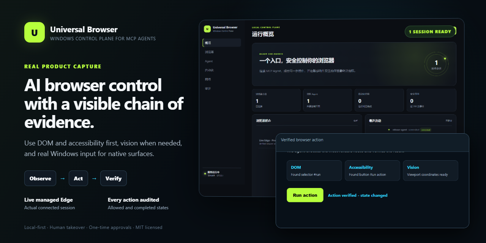
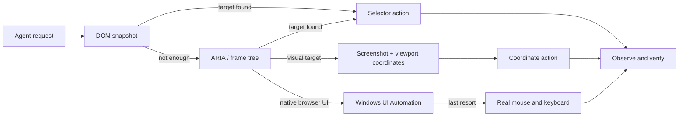
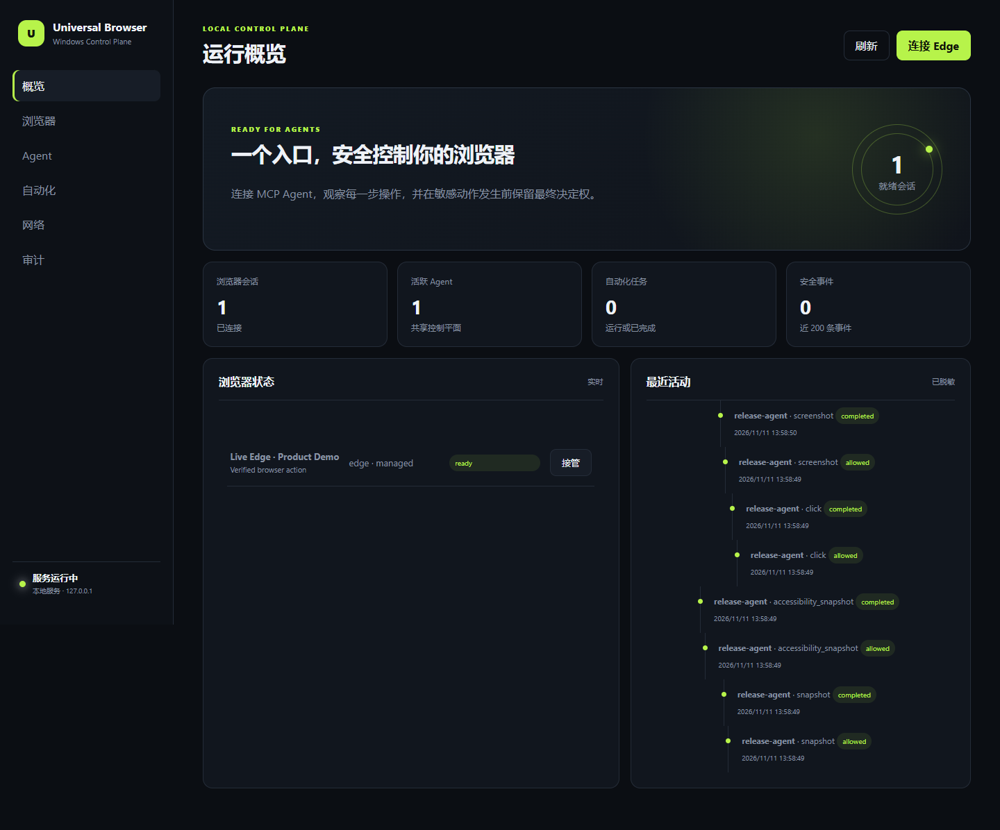

<p align="center">
  
</p>

<h1 align="center">Universal Browser — Windows</h1>

<p align="center">
  Give MCP-compatible AI agents a local, observable control plane for the browser.<br>
  DOM when possible. Vision when necessary. Real Windows input when nothing else works.
</p>

<p align="center">
  <a href="https://github.com/gwttk9bwg2-bit/universal-browser-windows/releases"></a>
  <a href="https://github.com/gwttk9bwg2-bit/universal-browser-windows/actions/workflows/ci.yml"></a>
  <a href="LICENSE"></a>
  
  
</p>

<p align="center">
  <a href="docs/INSTALL.zh-CN.md">中文安装说明</a> ·
  <a href="docs/ARCHITECTURE.md">Architecture</a> ·
  <a href="SECURITY.md">Security</a> ·
  <a href="docs/TROUBLESHOOTING.md">Troubleshooting</a> ·
  <a href="CONTRIBUTING.md">Contributing</a>
</p>



> **Product principle:** if a person can operate a browser surface, the agent should have a deliberate route to observe and operate it—without pretending that browser security boundaries do not exist.

Universal Browser is a local-first Windows plugin and MCP server for Microsoft Edge, Google Chrome/Chromium, and Mozilla Firefox. It gives an agent one workflow across managed automation, an existing signed-in browser, visual coordinates, Windows UI Automation, and real mouse/keyboard input.

## Install in about a minute

1. Open [Releases](https://github.com/gwttk9bwg2-bit/universal-browser-windows/releases/latest) and download `universal-browser-windows-1.0.0-portable.zip`.
2. Extract the ZIP to a normal folder.
3. Double-click `install.cmd`.
4. Restart Codex and ask it to use the browser.

That is the default path. The installer places the app in `%LOCALAPPDATA%\UniversalBrowser`, installs production dependencies, adds the MCP entry and Skill to Codex, and keeps a configuration backup. The local service and a managed browser start only when an agent needs them. The Dashboard is optional.

Need an existing login? Run `connect-existing-browser.cmd` once and follow the Edge/Chrome extension prompt.

| Task | File |
| --- | --- |
| First install | `install.cmd` |
| Use an already signed-in Edge/Chrome profile | `connect-existing-browser.cmd` |
| Update from a newer extracted release | `update.cmd` |
| Remove the app and installer-managed configuration | `uninstall.cmd` |

## What the agent can do

- **Observe:** DOM text and controls, ARIA accessibility, child frames, open Shadow DOM, screenshots, Windows UI Automation, console/network/WebSocket events, and HAR export.
- **Interact:** navigate, manage tabs, click selectors or viewport coordinates, type, press keys, select values, scroll, drag, upload, download, handle JavaScript dialogs, and follow popup tabs.
- **Use real Windows input:** focus windows, move/click the cursor, scroll, drag, type text, send hotkeys, inspect or invoke native UI controls, and capture the virtual screen.
- **Run repeatable work:** queued automations, retries, timeouts, pause/resume/cancel, browser assertions, audit history, and multi-agent write locking.
- **Stop safely:** human takeover, CAPTCHA pause, one-time sensitive/destructive approvals, credential redaction, and observable post-action verification.

## How it chooses an interaction route



The bundled Skill applies confidence thresholds, rejects stale coordinates, re-observes after state changes, and stops instead of clicking nearby controls speculatively.

## Connection modes

| Mode | Best for | Login state | Coverage |
| --- | --- | --- | --- |
| Managed Playwright | Default reliable automation and testing | Isolated profile | Full DOM/ARIA, frames, Shadow DOM, upload/download, dialog, popup, permissions, screenshot coordinates |
| Extension + native host | Existing signed-in Chrome/Edge/Firefox | Current browser profile | Tabs, DOM/ARIA, frames, screenshot coordinates, network events; browser-policy fallbacks are explicit |
| CDP attachment | Existing Chromium debugging endpoint | Endpoint profile | Chromium-only, lower fidelity than managed mode |
| Windows fallback | Browser chrome, native permission/file dialogs, inaccessible surfaces | Current desktop | UI Automation, real input, window focus, and screen capture |

Firefox extension uploads and JavaScript dialogs use managed mode or Windows fallback. CAPTCHA always remains a human step. Browser-internal pages may require native fallback.

## Dashboard

The Dashboard is a local status and audit surface, not a required setup step. Open `http://127.0.0.1:3210` only when you want to inspect sessions, agents, tasks, network activity, or audit entries.



## MCP tools

The server exposes a small task-oriented surface:

- `browser_status`, `browser_connect`, `browser_disconnect`
- `browser_observe`, `browser_action`, `windows_action`
- `control_acquire`, `control_release`, `approval_create`, `human_resume`
- `browser_events`, `network_har`, `audit_log`, `automation_create`

Codex is configured automatically by `install.cmd`. Other MCP clients can import `%LOCALAPPDATA%\UniversalBrowser\mcp-config.json` or connect to the local Streamable HTTP endpoint at `http://127.0.0.1:3210/mcp`.

## Security model

- Binds to loopback by default; native and direct MCP transports support a generated local token.
- Browser writes require the global control lock; human takeover clears it immediately.
- Uploads, permission grants, arbitrary evaluation, and destructive actions require explicit intent plus a short-lived one-use approval token.
- Audit and event output redact common password, cookie, authorization, credential, secret, and token fields.
- Page content is untrusted data and cannot grant local permissions or override the user's request.
- CAPTCHA is detected and pauses the session for human completion.

Read the full [security policy](SECURITY.md) before exposing or modifying the transport.

## Verification status

Release 1.0.0 was prepared with:

- 10 passing test files and 15 passing local tests.
- Real Microsoft Edge coverage for screenshot coordinates, iframe, Shadow DOM, upload/download, JavaScript dialogs, popup tabs, Windows UI Automation, and MCP-managed zero-setup connection.
- Windows CI that installs and exercises Playwright Chromium and Firefox.
- TypeScript typecheck, production build, Skill validation, isolated install/update/uninstall verification, and a production dependency audit reporting zero known vulnerabilities at release preparation time.

See the [1.0.0 release notes](docs/RELEASE_NOTES_1.0.0.md) for the full delivery boundary.

## Develop from source

Requirements: Windows 10/11, Node.js 22+, and at least one supported browser.

```powershell
npm ci
npm run check
npm start
```

Useful commands:

```powershell
npm run dev
npm run test:e2e
npm run mcp
powershell -File scripts/diagnose-windows.ps1
powershell -File scripts/build-release.ps1
```

The project uses an MIT license. Contributions are welcome; please read [CONTRIBUTING.md](CONTRIBUTING.md) and the [Code of Conduct](CODE_OF_CONDUCT.md).
