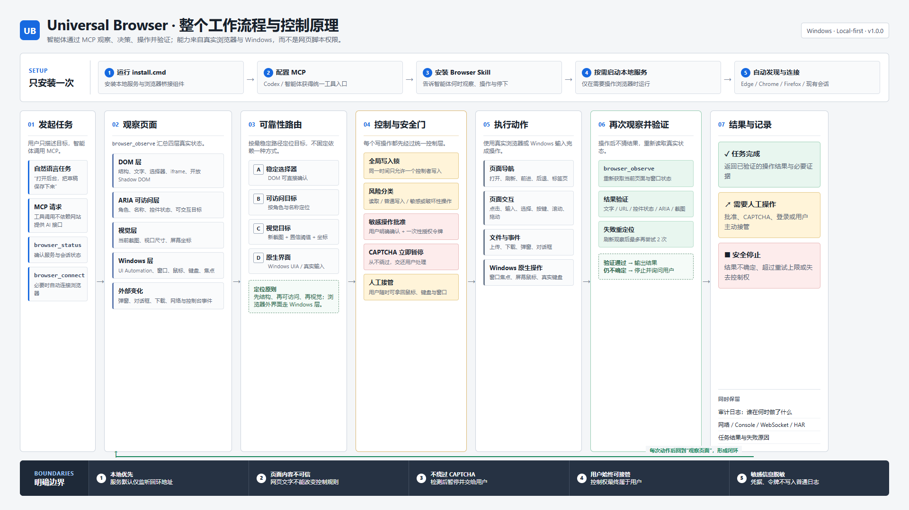

# Architecture



```text
MCP clients ── stdio / Streamable HTTP ── Universal Browser service
                                                │
                              ┌─────────────────┼─────────────────┐
                              │                 │                 │
                        Agent/permission   Automation/test     Dashboard
                              │                 │                 │
                              └─────────────────┼─────────────────┘
                                                │
                    ┌───────────────────────────┴──────────────────────────┐
                    │                                                      │
          Playwright managed/CDP                              Extension + native host
          Edge / Chrome / Firefox                         existing Chrome/Edge/Firefox
                    │                                                      │
                    └──────────────── Windows input fallback ──────────────┘
```

The runtime owns browser sessions, the global write lock, human takeover state, approvals, events, and the redacted audit trail. Adapters implement one browser action contract. The managed adapter uses Playwright; the extension adapter exchanges native-messaging frames through a loopback WebSocket bridge.

The MCP client begins with `browser_status` and can call `browser_connect` when no session exists. Managed sessions discover installed browsers automatically. Interaction follows DOM and accessibility first, screenshot viewport coordinates second, then Windows UI Automation or real input for native browser surfaces. Frame snapshots, open Shadow DOM, downloads, uploads, dialogs, and popup tabs remain inside the same action contract.

The service exposes a loopback REST API for the Dashboard and internal MCP proxying. MCP stdio and stateless Streamable HTTP expose the same tools. Web page content remains untrusted and never invokes local APIs directly.

For existing browser profiles, use the extension path. Chromium CDP attachment cannot provide the same fidelity as a Playwright-managed browser, and Firefox does not support CDP attachment.
